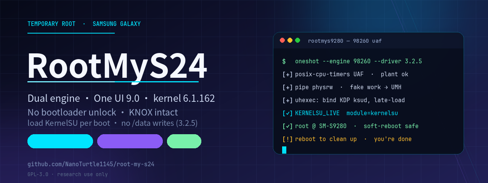

<p align="center">
  
</p>

<h1 align="center">RootMyS24</h1>

<p align="center">
  Temporary root for Samsung Galaxy devices without unlocking the bootloader — root lasts until reboot,<br>
  nothing is written to boot, KNOX e-fuse stays intact.<br>
  Dual engine: <strong>CVE-2026-98260</strong> (98260 UAF, One UI 9.0 / kernel 6.1.162) ·
  <strong>CVE-2026-43499</strong> (GhostLock, 6.1.145 and older)
</p>

<p align="center">
  <a href="https://github.com/NanoTurtle1145/root-my-s24/releases"></a>
  <a href="https://github.com/NanoTurtle1145/root-my-s24/releases"></a>
  <a href="https://github.com/NanoTurtle1145/root-my-s24/stargazers"></a>
  <a href="LICENSE"></a>
  <a href="https://github.com/NanoTurtle1145/root-my-s24/blob/main/CONTRIBUTING.md"></a>
</p>

<p align="center">
  <a href="README.md">简体中文</a> · <a href="README.zh-TW.md">繁體中文（台灣）</a> · <a href="README.zh-HK.md">繁體中文（香港）</a> · <b>English</b>
  &nbsp;|&nbsp; <a href="docs/README.md">Docs</a> · <a href="CONTRIBUTING.md">Contributing</a> · <a href="docs/PRIVACY.md">Privacy</a>
</p>

> **Disclaimer**: for security research and your own devices only. Kernel exploitation can crash the system, lose data or brick the device; you accept the risk. Do not use it on devices you do not own.

---

## 1. What this is

A one-tap **temporary root** for Samsung Galaxy devices (mainly S24 series and foldables):

- **No bootloader unlock**: nothing is flashed, `boot` is untouched, `ro.boot.flash.locked` stays `1`
- **KNOX intact**: the e-fuse is not tripped (`warranty_bit` stays `0`)
- **Semi-persistent**: run the app once per boot to late-load the KernelSU driver; reboot to clean up
- **Two engines**: 98260 UAF for new firmware, GhostLock 43499 for older builds
- **KernelSU late-load**: Zygisk Next / LSPosed / KnoxPatch and friends work as usual

| Engine | Vulnerability | Firmware | Notes |
|---|---|---|---|
| **98260 UAF** | CVE-2026-98260 (`exec: Cleanup POSIX timers right after de_thread()`, posix-cpu-timers UAF) | One UI 9.0 / kernel 6.1.162 | Reference implementation: [SamTimer v1.3](https://github.com/RiosWesley/SamTimer); UMH chain, **never writes creds**, so KDP/RKP/DEFEX are not triggered |
| **GhostLock 43499** | CVE-2026-43499 (rtmutex/futex waiter kernel-stack UAF) | 6.1.145 and older | The original engine of this project; patched on newer builds |

## 2. Quick start

### Requirements

| Item | Requirement |
|---|---|
| Device | Firmware build must be listed in "Supported devices" below |
| Authorization | **Shizuku** (recommended) or the in-app wireless-debugging option |
| Manager | **Officially signed** KernelSU manager matching your driver (see below) |
| Environment | Screen off during the run, low system load, do not background the app |

### Three steps

1. Pick your model/firmware on the model screen
2. Pick engine + driver: One UI 9.0 → `98260 UAF` + driver `3.2.5`; older firmware → `GhostLock`
3. Tap **Start Root**, install the manager, `su` works

### The manager version must match the driver

| Driver selected in app | Manager to install |
|---|---|
| **3.2.5 (32525)** — default for 98260 | official **v3.2.5 (32525)** |
| 3.3.0 (32601) — experimental | official **v3.3.0 (32601)** |

> A mismatch usually shows "Not installed" or fails to install modules even if `su` works in a terminal. Only the officially signed manager is accepted; re-signed or repacked builds always show "Not installed".
> **Never tap "Install / Update" inside the manager** — that writes the boot image (permanent install) and can brick a locked device. Use the "Modules" page only.

### Three hard rules for the 98260 engine

1. **One attempt per boot** — after a failure or a soft reboot, reboot before retrying; a dirty kernel state panics mid-plant (the app blocks this since v3.6.2)
2. **Do not use the 3.3.0 driver** — it can crash-loop `system_server` on 6.1.162; use 3.2.5
3. **If you see `parking without reap (zombie held)`, reboot** — it is a protective action (the parked process holds the pages); never force-kill it

### Reporting a problem

Run logs → "Copy log ID" (v3.6.3+), paste the **log ID** into an issue; the templates ask for device, firmware, kernel, engine and driver. A full log paste works too.

## 3. Supported devices

### Verified on real devices

| Model | Build | Kernel | Payload | Status |
|---|---|---|---|---|
| SM-S9280 (CHC DZF2) | S9280ZCS6DZF2 | 6.1.145 | `cve-2026-43499-S9280ZCS6DZF2` | baseline |
| SM-S9280 (CHC DZH3) | S9280ZCS6DZH3 | 6.1.145 | same as DZF2 | verified |
| SM-S9280 (HK/TW DZE2) | S9280ZHS6DZE2 | 6.1.145 | `cve-2026-43499-dze2` | verified (HK/TW share it) |
| SM-S9280 (HK/TW DZH3) | S9280ZHS6DZH3 | 6.1.145 | as DZE2 | verified |
| SM-S9280 (CHC DZG1) | S9280ZCS6DZG1 | 6.1.145 | as DZF2 | verified |
| SM-S9210 (CHC DZI1) | S9210ZCS6DZI1 | 6.1.145 | `cve-2026-43499-S9210ZCS6DZI1` | verified |
| SM-S9260 (TW DZG1) | S9260ZHS6DZG1 | 6.1.145 | HK/TW DZE2 | verified (single device) |
| SM-F741N (KR Z Flip6) | F741NKSS4DZE1 | 6.1.145 | `cve-2026-43499-F741NKSS4DZE1` | verified |
| SM-F9580 (CHC Z Fold6) | shares DZF2 | 6.1.145 | as DZF2 | verified |
| SM-S928B (EU S24U, One UI 9.0) | S928BXXU6EZIF | 6.1.162 | `cve-2026-43499-S928BXXU6EZIF` | verified |
| **SM-S9280 (HK/CHC EZIF, One UI 9.0)** | S9280ZHU6EZIF | 6.1.162 | **98260 UAF** engine | **verified**, KSU 3.2.5 driver |
| SM-S921E (global S24, One UI 9.0) | S921EXXU3DZIF | 6.1.162 | 98260 UAF (same build 34343818) | verified (issue #33) |
| SM-S928B (EU S24U EZJ1) | S928BXXS6EZJ1 | 6.1.162 | 98260 UAF (same build) | verified (issue #32) |
| SM-S921W (CA S24, One UI 9.0) | S921USQU6EZIF | 6.1.162 | 98260 UAF (same build) | reported working (issue #42) |

### Other entries

- **Calibrated, awaiting device verification**: CZA1 / CZB2 / BYH7 / S25 CZG1 / S928B AXK5·BYD9·CZA1 / W23 — see the Simplified Chinese README tables.
- **Community 98260 target**: `S9280ZCS6DZJ3` (CHC DZJ3, 6.1.145) — merged via PR #44, verified by manual staging, `tested=false` until an in-app run log exists.
- **Ported payloads** (unverified, enable "Show untested payloads"): S23/S24/S25/S26/foldables/Heart-of-the-World ports from RootMyGalaxy — see the Chinese README.

### How matching works

Payloads are matched by **kernel build number**, not by model name or region:

- Same platform + same build number → same symbols, payload is reusable (HK and TW builds share theirs)
- Different build number → needs symbol-by-symbol re-calibration
- Different platform, even with the same build number → still needs re-checking (e3q vs e1q differ in 11 offsets)
- **EZIF entries also cover EZJ1** (`S9280ZHS6EZJ1` / `S928BXXS6EZJ1`): same kernel build `34343818`, use the 98260 engine with the 3.2.5 driver

> ⚠ **US S24 models (SM-S921U / SM-S926U1 / S928U / S928U1) are not supported yet.** US builds differ (`kmalloc_caches` 0x176c6f8 US vs 0x176cbb8 CHC). S926U1 DZE2 is calibrated but unreleased pending a device test; S928U/U1 kernels have not been extracted yet.

## 4. Engines and drivers (advanced)

### The 98260 UAF chain

```
timer UAF -> pipe read/write primitive -> fake workqueue -> call_usermodehelper
-> uhexec -> bind-mount KDP ksud in a private mount ns -> late-load the KernelSU driver
```

- The exploit runs inside a **Shizuku UserService** persistent process, so backgrounding the app does not kill it
- `parking without reap (zombie held)` is intentional: the victim stays a zombie so the kernel never walks the panicking cleanup path
- Since v3.6.2 there is a **safe teardown**: before parking, the three CPU-clock timerqueue roots of the held victim are nulled, so a soft reboot no longer escalates into a hard reboot (patch submitted upstream as [SamTimer PR #2](https://github.com/RiosWesley/SamTimer/pull/2))

### Per-target payload layout

The shared payload is `samtimer/libtimer` (EZIF/EZJ1). Other builds add their own target, **without touching the shared payload**:

```
app/src/main/assets/samtimer/targets/<TAG>/libtimer   # required
app/src/main/assets/samtimer/targets/<TAG>/uhexec     # optional
app/src/main/assets/samtimer/targets/<TAG>/ksud       # optional
```

- `<TAG>` is the full build code in upper case (e.g. `S9280ZCS6DZJ3`); the app prefers the target directory and falls back to the shared payload
- Merged so far: `S9280ZCS6DZJ3` (community port, PR #44 — verified on device via manual staging, `tested=false` until an in-app run log exists)
- Porting flow and PR requirements: [CONTRIBUTING.md](CONTRIBUTING.md)

### Driver versions

| Version | Use | Notes |
|---|---|---|
| **3.2.5 (32525)** | 98260 engine (default) | **Recommended.** `--ephemeral` late-load: no /data/adb writes, no module stages, no manager restart, no soft reboot |
| 3.3.0 (32601) | GhostLock legacy / experimental | Supports SELinux hiding; occasional `system_server` crash loop on 6.1.162 — **not recommended** for 98260 |

The list is delivered by the online payload manifest and only applies to firmware that actually ships that driver.

### BakaSU kernel mode (experimental)

A settings toggle (off by default) that loads a Samsung-adapted BakaSU LKM instead of KernelSU:

- Verified only on **SM-S9280 / S9280ZCS6DZH3 (6.1.145)**
- Must be re-run every boot; **do not use "Install" in its manager**
- See [docs/bakasu-kernel-mode.md](docs/bakasu-kernel-mode.md)

## 5. Caveats

- **Stay on a supported build** — newer firmware may have fixed the bug
- Exploits are probabilistic: GhostLock can be retried, **98260 needs a reboot after a failure**
- Keep the screen off during the run and avoid heavy load; success rate drops sharply under load
- Re-run "Start Root" after every reboot
- **Do not linger after success**: a parked process holds kernel pages; reboot when you are done and avoid long heavy sessions
- Manager version must match the driver and be officially signed
- The 3.3.0 driver is unstable on 6.1.162

## 6. Version history

| Version | Date | Highlights |
|---|---|---|
| [v3.6.4-beta.1](docs/release-v3.6.4-beta.1.md) | 2026-11-14 | Pre-release: per-target payloads (first: DZJ3), #35 disable-modules via `disable` markers |
| [v3.6.3](docs/release-v3.6.3.md) | 2026-11-10 | Local run-log archive + log IDs, local history list |
| [v3.6.2](docs/release-v3.6.2.md) | 2026-11-08 | Safe teardown (soft reboot no longer hard-reboots), one-attempt-per-boot enforcement |
| [v3.6.0](docs/release-v3.6.0.md) | 2026-11-07 | Added the 98260 UAF engine (dual-engine switch) |

Full history: [docs/README.md](docs/README.md).

## 7. Project layout

```
RootMyS24/
├── app/                     main app (Kotlin + Jetpack Compose)
│   └── src/main/
│       ├── kotlin/.../rootmy/   exploit orchestration (engines, payloads, UserService)
│       ├── cpp/                 exploit sources (timer_samtimer.c, targets/<TAG>/)
│       ├── aidl/                UserService interfaces
│       └── assets/              bundled payloads (GhostLock, samtimer/, per-target)
├── manager-ui/              shared manager UI module
├── services/manager-service/ foreground service module
├── server/                  online endpoints (announcements, payload manifest, stats)
├── tools/                   build and release scripts
├── docs/                    documentation (releases, calibration reports, privacy)
└── .github/                 CI workflow + issue templates
```

## 8. Building

```sh
./gradlew :app:assembleDebug    # debug APK
./gradlew :app:assembleRelease  # release APK (configure your own signing)
```

`versionCode` is the commit count and `versionName` comes from the nearest git tag; pre-release channels append a suffix:

```sh
./gradlew :app:assembleRelease -Prms24Channel=alpha1   # engine experiments
./gradlew :app:assembleRelease -Prms24Channel=beta1    # device/firmware preview
./gradlew :app:assembleRelease -Prms24Channel=stable   # formal release
```

Artifacts are named `RootMyS24-v{version}-{channel}-build{versionCode}.apk`.

> Channels: `alphaN` = engine/framework experiments, `betaN` = device/firmware previews, `stable` = formal release.
> Pushing a `v*` tag triggers `.github/workflows/release.yml` (signed build + GitHub Release); see [docs/ci-release.md](docs/ci-release.md).

Payloads (exploit / root helper / ksud) are bundled in `app/src/main/assets/`; their build chain is the maintainer's responsibility.

If you fork and build your own APK, read the "如果你是 fork 后自行编译" section in the project `AGENTS.md`: change the statistics endpoints and use your own signing key first.

## 9. Documentation

Full index: [docs/README.md](docs/README.md).

| Topic | Docs |
|---|---|
| Getting started | [Quick start](#2-quick-start) · [Contributing](CONTRIBUTING.md) · [Authorization](docs/auth-plan.md) · [Privacy](docs/PRIVACY.md) |
| Internals | [Technical principles](docs/technical-principles.md) · [VULNERABILITY_ANALYSIS.md](https://github.com/NanoTurtle1145/samsung-root-research/blob/main/VULNERABILITY_ANALYSIS.md) |
| Porting | [Full adaptation guide](docs/adaptation-guide-full.md) · [CONTRIBUTING → device support](CONTRIBUTING.md) |
| Calibration reports | [DZJ3 (98260)](docs/port-98260-S9280ZCS6DZJ3.md) · [DZE2](docs/dze2-target-complete.md) · [CZA1](docs/cza1-target-complete.md) · [F741N](docs/f741n-dze1-target-complete.md) · [S928B EZIF](docs/s928b-ezif-target-complete.md) |
| Logs & debugging | [Run-log analysis](docs/run-log-analysis.md) |
| Build & release | [CI release](docs/ci-release.md) · [Separate builds](docs/separate-builds.md) |

## 10. How it works (summary)

- **98260 UAF**: a timing bug in `exec: Cleanup POSIX timers right after de_thread()` leaves a `timerqueue_node` use-after-free. A pipe read/write primitive builds a fake workqueue, `call_usermodehelper` runs `uhexec` as root, which bind-mounts a KDP-patched ksud in a private mount namespace and late-loads the driver. Credentials are never forged, so KDP/RKP/DEFEX are not involved.
- **GhostLock 43499**: a kernel-stack use-after-free in rtmutex. Rolling back a PI-futex deadlock leaves a dangling pointer into a freed kernel stack; reusing that stack as a fake `rt_mutex_waiter` yields physical memory read/write, KASLR is bypassed, SELinux downgraded, and the helper finally late-loads KernelSU.

Neither chain touches persistent partitions; the bootloader stays locked and the KNOX e-fuse is not tripped. See [docs/technical-principles.md](docs/technical-principles.md).

## 11. Project data

> Anonymous aggregate statistics (optional in-app log sharing): no IP, city or device identifier. Charts are generated by the project server.

<p align="center"></p>
<p align="center"></p>
<p align="center"></p>
<p align="center"></p>

## 12. Credits

- [CVE-2026-43499](https://github.com/NebuSec/CyberMeowfia/tree/main/IonStack/CVE-2026-43499) research (IonStack / NebuSec)
- [SamTimer](https://github.com/RiosWesley/SamTimer) — reference implementation for the 98260 engine; safe-teardown patch submitted as [PR #2](https://github.com/RiosWesley/SamTimer/pull/2)
- [Root-My-Galaxy](https://github.com/BuSung-dev/Root-My-Galaxy) / [Root-My-Galaxy-Payloads](https://github.com/BuSung-dev/Root-My-Galaxy-Payloads) reference project and payloads (Apache-2.0)
- [KernelSU](https://github.com/tiann/KernelSU) (GPL-2.0), [Zygisk-Next](https://github.com/Dr-TSNG/ZygiskNext), [LSPosed](https://github.com/LSPosed/LSPosed) (GPL-3.0), [KnoxPatch](https://github.com/salvogiangri/KnoxPatch)
- [Vector](https://github.com/JingMatrix/Vector) UI template (Material 3 / ambience)
- Everyone who reported devices and tested new firmware

## License

[GNU General Public License v3.0](LICENSE).
