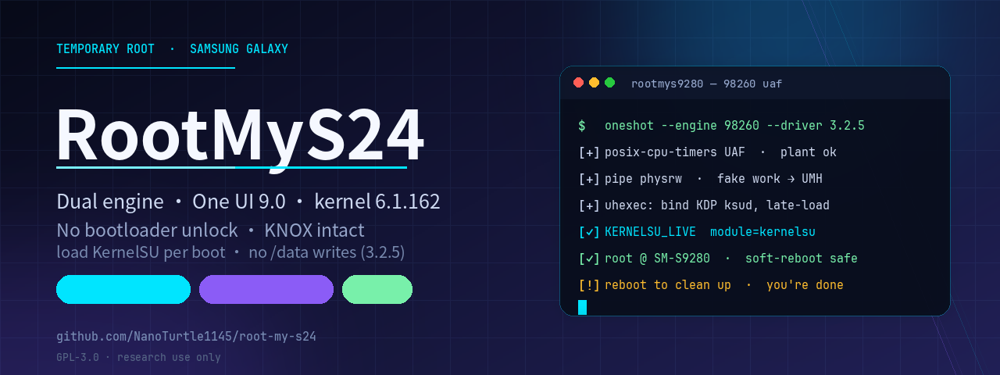

<p align="center">
  
</p>

<h1 align="center">RootMyS24</h1>

<p align="center">
  免解锁 bootloader 的三星临时 root · root 只活到重启，不写 boot、不熔断 KNOX<br>
  双引擎：<strong>CVE-2026-98260</strong>（98260 UAF，One UI 9.0 / 6.1.162）·
  <strong>CVE-2026-43499</strong>（GhostLock，6.1.145 及更早）
</p>

<p align="center">
  <a href="https://github.com/NanoTurtle1145/root-my-s24/releases"></a>
  <a href="https://github.com/NanoTurtle1145/root-my-s24/releases"></a>
  <a href="https://github.com/NanoTurtle1145/root-my-s24/stargazers"></a>
  <a href="LICENSE"></a>
  <a href="https://github.com/NanoTurtle1145/root-my-s24/blob/main/CONTRIBUTING.md"></a>
</p>

<p align="center">
  <b>简体中文</b> · <a href="README.zh-TW.md">繁體中文（台灣）</a> · <a href="README.zh-HK.md">繁體中文（香港）</a> · <a href="README.en.md">English</a>
  &nbsp;|&nbsp; <a href="docs/README.md">文档中心</a> · <a href="CONTRIBUTING.md">贡献指南</a> · <a href="docs/PRIVACY.md">隐私政策</a>
</p>

> **声明**：仅用于安全研究与自有设备维护。使用内核漏洞提权存在系统崩溃、数据丢失、设备变砖的风险，后果自负；请勿用于非法用途。
> 运行日志共享是可选项，怎么上报、设备标识与 IP 如何处理见[隐私政策](docs/PRIVACY.md)。

---

## 一、这是什么

一个跑在三星 Galaxy（主要是 S24 系列及折叠屏）上的**临时 root** 工具：

- **免解锁**：不刷 BL、不写 boot，`ro.boot.flash.locked` 保持 1
- **不熔断**：KNOX e-fuse 不变（`warranty_bit` 保持 0）
- **半持久**：每次重启后跑一次 App 重新加载 KernelSU 驱动，重启即干净
- **双引擎**：新固件走 98260 UAF，旧固件走 GhostLock 43499
- **一条链路到 KernelSU**：拿到 root 后 late-load KernelSU LKM，支持 Zygisk Next / LSPosed / KnoxPatch 等模块

| 引擎 | 漏洞 | 适用固件 | 关键点 |
|---|---|---|---|
| **98260 UAF** | CVE-2026-98260（`exec: Cleanup POSIX timers right after de_thread()`，posix-cpu-timers UAF） | One UI 9.0 / 内核 6.1.162 | 实现参考 [SamTimer v1.3](https://github.com/RiosWesley/SamTimer)；UMH 链路，**不写 cred**，不撞 KDP/RKP/DEFEX |
| **GhostLock 43499** | CVE-2026-43499（rtmutex/futex waiter 内核栈 UAF） | 6.1.145 及更早 | 本项目的原始引擎；较新固件已修复 |

## 二、快速开始

### 需要什么

| 项 | 要求 |
|---|---|
| 设备 | 见下方「支持设备」表；固件构建号必须在覆盖范围内 |
| 授权 | **Shizuku**（推荐）或 App 内「无线调试」直连 |
| 管理器 | 与驱动版本匹配的**官方签名** KernelSU 管理器（见下表） |
| 环境 | 建议熄屏运行、系统负载低、一轮跑完前别切后台 |

### 三步

1. **选机型固件** → 机型页选你的构建号
2. **选引擎与驱动** → One UI 9.0 选 `98260 UAF` + 驱动 `3.2.5`；旧固件选 `GhostLock`（默认驱动即可）
3. **开始 Root** → 成功后装管理器，`su` 即可用

### 管理器版本必须与驱动匹配

| App 里选的驱动 | 装哪个管理器 |
|---|---|
| **3.2.5（32525）** — 98260 默认 | 官方 **v3.2.5（32525）** |
| 3.3.0（32601）— 实验 | 官方 **v3.3.0（32601）** |

> 版本错配时 `su` 可能还能用，但管理器会显示「未安装」或装不了模块。重签名 / fork 版管理器一律「未安装」（驱动只认官方签名）。
> **不要点管理器里的「安装 / 刷入」**：那是永久安装，会写 boot，锁定 BL 上有变砖风险。装模块只用「模块」页。

### 98260 引擎的三条硬规则

1. **一次开机只跑一次** —— 失败 / 软重启后先重启手机再跑，脏状态继续跑会在 plant 中途 panic（v3.6.2 起 App 会直接拦截）
2. **别用 3.3.0 驱动** —— 该驱动在 6.1.162 上会让 system_server 崩溃循环，用 3.2.5
3. **看到 `parking without reap (zombie held)` 就重启** —— 这是保护动作（parked 进程拿住页），不能强杀

### 出问题了怎么反馈

运行日志页 →「复制编号」（v3.6.3 起），把**日志编号**贴进 issue 即可；模板会自动要求机型、固件、内核、引擎、驱动。没有编号时贴完整日志也行。

## 三、支持设备

### 已实测成功

| 机型 | 固件 | 内核 | 载荷 | 状态 |
|---|---|---|---|---|
| SM-S9280（国行 DZF2） | S9280ZCS6DZF2 | 6.1.145 | `cve-2026-43499-S9280ZCS6DZF2` | 基线，已实测 |
| SM-S9280（国行 DZH3） | S9280ZCS6DZH3 | 6.1.145 | 同 DZF2 | 已实测，KernelSU 3.3.0 适配完成 |
| SM-S9280（港版/台版 DZE2） | S9280ZHS6DZE2 | 6.1.145 | `cve-2026-43499-dze2` | 已实测（港台同构建号共用） |
| SM-S9280（港版/台版 DZH3） | S9280ZHS6DZH3 | 6.1.145 | 同外版 DZE2 | 已实测（外版共用） |
| SM-S9280（国行 DZG1） | S9280ZCS6DZG1 | 6.1.145 | 同 DZF2 | 已实测（v2.5.6 起并入） |
| SM-S9210（国行 DZI1） | S9210ZCS6DZI1 | 6.1.145 | `cve-2026-43499-S9210ZCS6DZI1` | 已实测（attempt 1/24，e1q） |
| SM-S9260（台版 DZG1） | S9260ZHS6DZG1 | 6.1.145 | 港台 DZE2 载荷 | 单设备实测（issue #3） |
| SM-F741N（韩版 Z Flip6） | F741NKSS4DZE1 | 6.1.145 | `cve-2026-43499-F741NKSS4DZE1` | 已实测（beta.191，issue #16） |
| SM-F9580（国行 Z Fold6） | 共用 DZF2 | 6.1.145 | 同 DZF2 | 酷安用户实测成功 |
| SM-S928B（欧版 S24 Ultra，One UI 9.0） | S928BXXU6EZIF | 6.1.162 | `cve-2026-43499-S928BXXU6EZIF` | 已实测（2026-10-23） |
| **SM-S9280（港版/国行 EZIF，One UI 9.0）** | S9280ZHU6EZIF | 6.1.162 | 引擎：**98260 UAF**（实现参考 SamTimer v1.3） | **已实测（2026-11-07）**，KSU 3.2.5 驱动 |
| SM-S921E（国际版 S24，One UI 9.0） | S921EXXU3DZIF | 6.1.162 | 引擎：98260 UAF（与 EZIF 同内核构建 34343818） | 已实测（2026-11-07，issue #33） |
| SM-S928B（欧版 S24 Ultra，EZJ1） | S928BXXS6EZJ1 | 6.1.162 | 引擎：98260 UAF（同 34343818） | 已实测（2026-11-10，issue #32） |

### 已定标，待真机验证

| 机型 | 固件 | 内核 | 载荷 | 备注 |
|---|---|---|---|---|
| SM-S9280（港版/台版 CZA1） | S9280ZHS4CZA1 | 6.1.128 | `cve-2026-43499-cza1` | 港台共用 |
| SM-S9280（国行 CZA1） | S9280ZCS4CZA1 | 6.1.128 | `cve-2026-43499-cza1-chc` | 数据段偏移 +0x10000 |
| SM-S9280（国行 CZB2） | S9280ZCS4CZB2 | 6.1.128 | `cve-2026-43499-czb2` | 独立定标 + 32525 ksud |
| SM-S9210（国行 BYH7，One UI 7） | S9210ZCU4BYH7 | 6.1.99 | `cve-2026-43499-byh7` | 6.1.145 之前代际 |
| SM-S9310/S9360/S9380（国行 S25，One UI 8.5） | S9310/S9360/S9380ZCSCCZG1 | 6.6.98 | `cve-2026-43499-czg1` | Android 15 内核线，独立载荷 |
| SM-S928B（欧版，One UI 8.0） | S928BXXS4CZA1 | 6.1.128 | `cve-2026-43499-S928BXXS4CZA1` | 与港版 CZA1 同构建号但 `.rodata` 差 8 字节，**不可互换** |
| SM-S928B（欧版，One UI 7.0） | S928BXXU4BYD9 | 6.1.99 | `cve-2026-43499-S928BXXU4BYD9` | 独立定标 |
| SM-S928B（欧版，One UI 6.1） | S928BXXU4AXK5 | 6.1.75 | `cve-2026-43499-S928BXXU4AXK5` | 本 App 支持的最早 6.1 代际 |
| W9023N（国行 心系天下 W23） | W9023ZCSAIZF1 | 5.10.236 | `cve-2026-43499-W9023ZCSAIZF1` | cape/SM8450，Android 12，beta |
| **SM-S9280（国行 DZJ3）** | S9280ZCS6DZJ3 | 6.1.145 | 引擎：**98260 UAF**（per-target `samtimer/targets/S9280ZCS6DZJ3`） | 社区定标（#40/PR #44）：手动 staging 真机 root 成功；App 内待验证（`tested=false`） |

### 移植载荷（未经本 App 真机实测）

以下条目由 RootMyGalaxy 移植，运行时按 KASLR 定标，需在设置里打开「启用未经测试的载荷」才显示：

| 系列 | 平台/内核 | 覆盖 |
|---|---|---|
| S23（S9110/S9160/S9180） | 5.15 | 国行 FZE3 / FZG1，港版 FZE3+ |
| S24（S9210/S9260/S9280） | 6.1.145 | 国行 DZE2 / DZF2 / DZG1，港台 DZG1 |
| S25（S9310/S9360/S9370/S9380） | 6.6 | 国行 BZA1 / BZC1 / CZF1 / CZG1，港版 CZG1 |
| S26（S9420/S9470/S9480） | 6.12 | 国行 AZG1 |
| 折叠屏 | 5.15 / 6.1 / 6.6 | Z Flip5/6/7、Z Fold5/6/7 国行，F956U 美版，F966B 欧版 |
| 心系天下 | 6.1 / 6.6 | W25 DZF2/DZG3、W26 BZG3/BZF1 |

> 同平台（e3q/e1q）同构建号固件内核符号一致，可直接通用；港版与台版同构建号共用同一载荷。跨构建号需逐符号对比修正；跨平台/跨大版本需完整重新定标，且漏洞可能已被修复。适配方法与各目标定标报告见[文档导航](#九文档导航)。
>
> **EZIF 条目同时覆盖 EZJ1（S9280ZHS6EZJ1 / S928BXXS6EZJ1）**：内核构建号同为 `34343818`，只是新构建串；
> 用 98260 引擎 + 3.2.5 驱动即可（不要用 3.3.0，该模块在 6.1.162 上会让 system_server 崩溃循环）。
>
> **国行 DZF2 载荷自 v3.5.0 起覆盖 DZE2–DZH3**（同一条 6.1.145 内核线）；外版 DZE2 载荷覆盖 DZE2–DZG1。
>
> ⚠ **美版 S24 系列（SM-S921U / S926U1 / S928U / S928U1）暂不支持**。按内核构建号为单位适配：美版 DZF2 构建号与国行不同，`kmalloc_caches` 0x176c6f8（美版）vs 0x176cbb8（国行）。美版 S24+（S926U1/XAA）DZE2 已完成定标（`cve-2026-43499-dze2-xaa`，p0 指纹按美版内核重生成），因缺真机实测暂未随包发布；S928U/U1 尚未取到 boot 镜像，`.rodata` 字符串区未核对。

## 四、引擎与驱动（进阶）

### 98260 UAF 链路

```
timer UAF → pipe 读写原语 → 伪造 workqueue → call_usermodehelper
→ uhexec → 私有 mount ns 里 bind-mount KDP ksud → late-load 加载 KernelSU 驱动
```

- exploit 跑在 **Shizuku UserService 常驻进程**里，App 切后台不会被回收
- 失败时 `parking without reap (zombie held)` 是保护动作：让 victim 永远 zombie，内核走不到会 panic 的清理路径
- v3.6.2 起有**安全拆除（safe unlink）**：parked 前把 held victim 的 3 个 CPU-clock timerqueue 树根置空，软重启不再演变成硬重启（补丁已提交上游 [SamTimer PR #2](https://github.com/RiosWesley/SamTimer/pull/2)）

### 98260 载荷的 per-target 结构

公共载荷是 `samtimer/libtimer`（覆盖 EZIF/EZJ1）。其他构建号的适配按下面的约定叠加，**不改公共载荷**：

```
app/src/main/assets/samtimer/targets/<TAG>/libtimer   # 必需，按构建号编译的载荷
app/src/main/assets/samtimer/targets/<TAG>/uhexec     # 可选，与公共版本不同才放
app/src/main/assets/samtimer/targets/<TAG>/ksud       # 可选，公共 3.2.5 加载不了才放
```

- `<TAG>` = 完整构建号大写（如 `S9280ZCS6DZJ3`）；运行时优先 targets 目录，缺失回退公共载荷
- 目前已合入：`S9280ZCS6DZJ3`（社区贡献，PR #44；手动 staging 真机验证通过，App 内待验证 → `tested=false`）
- 适配流程与 PR 要求见 [CONTRIBUTING.md](CONTRIBUTING.md) →「98260 载荷适配」

### 驱动版本

| 版本 | 适用 | 说明 |
|---|---|---|
| **3.2.5（32525）** | 98260 引擎（默认） | **推荐**。`--ephemeral` late-load：不写 /data/adb、不跑 module stage、不自动打开管理器、不软重启 |
| 3.3.0（32601） | GhostLock 旧固件 / 实验 | 支持 SELinux 隐藏；6.1.162 上 stock 模块偶发 system_server 崩溃循环，98260 引擎**不推荐** |

版本清单由服务端在线下发，只对提供该驱动的固件生效，不适用的固件自动回退默认驱动并提示。

### BakaSU 内核模式（实验）

设置里「BakaSU 内核（实验）」开关（默认关）改用三星适配的 BakaSU LKM：

- 仅 **SM-S9280 / S9280ZCS6DZH3（6.1.145）** 实测通过
- 每次开机需重跑；**别点管理器「安装/刷入」**
- 详见 [docs/bakasu-kernel-mode.md](docs/bakasu-kernel-mode.md)，构建仓库 <https://github.com/NanoTurtle1145/BakaSU-S9280>

## 五、注意事项

- **停在已适配固件**：升级可能修掉漏洞；新固件优先按「支持设备」表核对构建号
- exploit 概率性成功：GhostLock 失败可多试，98260 **失败要重启**
- 运行期间建议熄屏、别切后台、别开省电；系统负载高时成功率骤降
- 每次重启后需要重新跑一次「开始 Root」
- **跑完别久留**：exploit 会留 parked 进程占住内核页，事情做完就重启；避免长时间高负载（游戏 / 大量后台 / 反复锁屏）
- **管理器版本与驱动匹配**且必须官方签名（见「二、快速开始」）
- 3.3.0 驱动在 6.1.162 上不稳（system_server 崩溃循环 → RescueParty → 整机重启）

## 六、版本历史

| 版本 | 时间 | 要点 |
|---|---|---|
| [v3.6.4-beta.1](docs/release-v3.6.4-beta.1.md) | 2026-11-14 | 预发布：per-target 载荷（首个 DZJ3）、#35 禁用模块改 disable 标记 |
| [v3.6.3](docs/release-v3.6.3.md) | 2026-11-10 | 运行日志本机存档 + 日志编号、本机历史日志 |
| [v3.6.2](docs/release-v3.6.2.md) | 2026-11-08 | 安全拆除（软重启不再硬重启）、一次开机一次尝试强制 |
| [v3.6.0](docs/release-v3.6.0.md) | 2026-11-07 | 新增 98260 UAF 引擎（双引擎切换） |
| [v3.5.x](docs/README.md#一入门与使用) | 2026-10 | KSU 3.3.0 适配、欧版 EZIF 支持、BakaSU 实验、地区分组等 |

完整历史见 [docs/README.md](docs/README.md) 的发布分组。

## 七、项目结构

```
RootMyS24/
├── app/                     主 App（Kotlin + Jetpack Compose）
│   └── src/main/
│       ├── kotlin/cn/nanoturtle/rootmys9280/manager/
│       │   ├── rootmy/      提权流程核心（RootViewModel / 引擎 / UserService / 载荷选择）
│       │   ├── ui/          Compose 界面（首页 / 机型页 / 设置 / 日志 / 关于）
│       │   ├── data/        日志解析与本地存储
│       │   ├── net/         服务端接口（公告 / 载荷清单 / 日志上报）
│       │   └── ipc/、di/    进程通信与依赖注入
│       ├── cpp/             exploit 源码
│       │   ├── timer_samtimer.c        98260 UAF 公共载荷（含 safe unlink）
│       │   └── targets/<TAG>/          按构建号的 offsets.h（如 S9280ZCS6DZJ3）
│       ├── aidl/            UserService 接口（IRootService / IRootCallback）
│       ├── assets/
│       │   ├── cve-2026-43499*         GhostLock 载荷与 root helper
│       │   └── samtimer/               98260 引擎：libtimer / uhexec / action 脚本 / ksud
│       │       └── targets/<TAG>/      per-target 载荷
│       ├── res/            多语言资源（20+ 语言）
│       └── AndroidManifest.xml
├── manager-ui/              管理器 UI 复用模块
├── services/manager-service/ 前台服务模块
├── server/                  自建接口（公告 / 载荷清单 / 论坛 / 统计）
├── tools/                   构建与发布脚本（ci_release / release_flavors / split_assets）
├── docs/                    文档：发布说明、定标报告、技术原理、隐私政策
├── .github/workflows/       CI：签名构建 + GitHub Release
└── .github/ISSUE_TEMPLATE/  Issue 模板（Bug / 成功反馈 / 功能建议）
```

各目录职责：

| 目录 | 职责 |
|---|---|
| `app/src/main/kotlin/.../rootmy/` | 双引擎调度、Shizuku/无线调试授权、载荷与驱动选择、late-load、日志 |
| `app/src/main/cpp/` | exploit 与载荷源码（按目标放 `targets/<TAG>/offsets.h`） |
| `app/src/main/assets/` | 随包分发的二进制载荷与脚本（构建链在开发者侧） |
| `server/` | App 在线能力：公告、载荷/驱动清单、运行统计、论坛 |
| `tools/` | 发布流水线辅助脚本 |
| `docs/` | 全部文档（索引见 [docs/README.md](docs/README.md)） |

## 八、构建

```sh
./gradlew :app:assembleDebug    # debug APK
./gradlew :app:assembleRelease  # release APK（需自行配置签名）
```

版本号由 git 推导（`versionCode` = 提交数，`versionName` = 最近的 tag），预发布渠道会追加后缀：

```sh
./gradlew :app:assembleRelease -Prms24Channel=alpha1   # 引擎试验包
./gradlew :app:assembleRelease -Prms24Channel=beta1    # 机型/固件适配预览
./gradlew :app:assembleRelease -Prms24Channel=stable   # 正式版
```

产物命名 `RootMyS24-v{版本}-{渠道}-build{versionCode}.apk`。

> 渠道语义：`alphaN` = 引擎/框架试验，`betaN` = 机型/固件适配预览，`stable` = 正式发布。
> 打 tag 推送到 GitHub 会触发 `.github/workflows/release.yml` 自动签名构建并发 Release（详见 [docs/ci-release.md](docs/ci-release.md)）。

载荷（exploit / root helper / ksud）已内置在 `app/src/main/assets/`，构建链属开发者职责。

## 九、文档导航

完整索引见 [docs/README.md](docs/README.md)。

| 分类 | 文档 |
|---|---|
| 入门 | [快速开始](#二快速开始) · [贡献指南](CONTRIBUTING.md) · [授权方案](docs/auth-plan.md) · [隐私政策](docs/PRIVACY.md) |
| 原理 | [技术原理](docs/technical-principles.md) · [研究仓库 VULNERABILITY_ANALYSIS.md](https://github.com/NanoTurtle1145/samsung-root-research/blob/main/VULNERABILITY_ANALYSIS.md) |
| 适配 | [完整适配指南 ⭐](docs/adaptation-guide-full.md) · [适配方法论](docs/adaptation-guide.md) · [CONTRIBUTING → 机型适配](CONTRIBUTING.md#机型适配最有价值的贡献) |
| 定标报告 | [DZJ3（98260）](docs/port-98260-S9280ZCS6DZJ3.md) · [S9210 DZI1](docs/port-e1q-S9210ZCS6DZI1.md) · [DZE2](docs/dze2-target-complete.md) · [CZA1](docs/cza1-target-complete.md) · [DZG1](docs/dzg1-target-complete.md) · [F741N DZE1](docs/f741n-dze1-target-complete.md) · [S928B EZIF](docs/s928b-ezif-target-complete.md) · [BYH7](docs/byh7-target-complete.md) |
| 日志与排障 | [运行日志判读](docs/run-log-analysis.md) · [SM-S9380 实战](docs/sm-s9380-rmg-root-experience.md) |
| 发布与 CI | [发布说明索引](docs/README.md#一入门与使用) · [CI 与发布](docs/ci-release.md) · [分系列构建](docs/separate-builds.md) |
| 实验 | [BakaSU 内核模式](docs/bakasu-kernel-mode.md) · [DirtyFrag 引擎规划](docs/dirtyfrag-engine-plan.md) |

## 十、技术原理（概要）

- **98260 UAF**：`exec: Cleanup POSIX timers right after de_thread()` 时序缺陷 → posix-cpu-timers 的 `timerqueue_node` use-after-free。pipe 读写原语伪造 workqueue → `call_usermodehelper` 以 root 执行 uhexec，在私有 mount ns 中 bind-mount KDP ksud 后 late-load。**不写 cred**，不触发 KDP/RKP/DEFEX 的凭据保护。
- **GhostLock 43499**：rtmutex 内核栈 use-after-free。PI futex 链死锁回滚触发错误清理路径，留下指向已释放内核栈的悬垂指针；复用该栈伪造 `rt_mutex_waiter` 获得物理内存读写，绕过 KASLR、降级 SELinux、以 root 执行 helper，最后 late-load KernelSU。

两条链都不改动持久化分区，bootloader 保持锁定、KNOX e-fuse 不熔断。详见 [docs/technical-principles.md](docs/technical-principles.md)。

## 十一、项目数据

> 匿名聚合统计（App 内可选的运行日志共享）：不含 IP、城市或任何设备标识；图表由项目服务器动态生成。

<p align="center">
  
</p>

<p align="center">
  
</p>

<p align="center">
  
</p>

<p align="center">
  
</p>

<details>
<summary>更多图表（地区分布 / Star 增长 / Issue-PR 历史 / 下载量）</summary>

<p align="center">
  
</p>

<p align="center">
  
</p>

<p align="center">
  
</p>

<p align="center">
  
</p>

</details>

## 十二、依赖与致谢

- [CVE-2026-43499](https://github.com/NebuSec/CyberMeowfia/tree/main/IonStack/CVE-2026-43499) 安全研究（IonStack / NebuSec）
- [SamTimer](https://github.com/RiosWesley/SamTimer) —— 98260 引擎参考实现；安全拆除补丁已回提 [PR #2](https://github.com/RiosWesley/SamTimer/pull/2)
- [Root-My-Galaxy](https://github.com/BuSung-dev/Root-My-Galaxy) / [Root-My-Galaxy-Payloads](https://github.com/BuSung-dev/Root-My-Galaxy-Payloads) 免解锁 root 参考工程与载荷（Apache-2.0）
- [KernelSU](https://github.com/tiann/KernelSU)（GPL-2.0）
- [Zygisk-Next](https://github.com/Dr-TSNG/ZygiskNext) · [LSPosed](https://github.com/LSPosed/LSPosed)（GPL-3.0）· [KnoxPatch](https://github.com/salvogiangri/KnoxPatch)
- [Vector](https://github.com/JingMatrix/Vector) 界面模板（Material 3 / ambience）
- 以及所有提交 issue、测试新固件的用户

## License

[GNU General Public License v3.0](LICENSE)。第三方组件许可见 [THIRD_PARTY_NOTICES](docs/README.md) 与各载荷目录内的声明。
