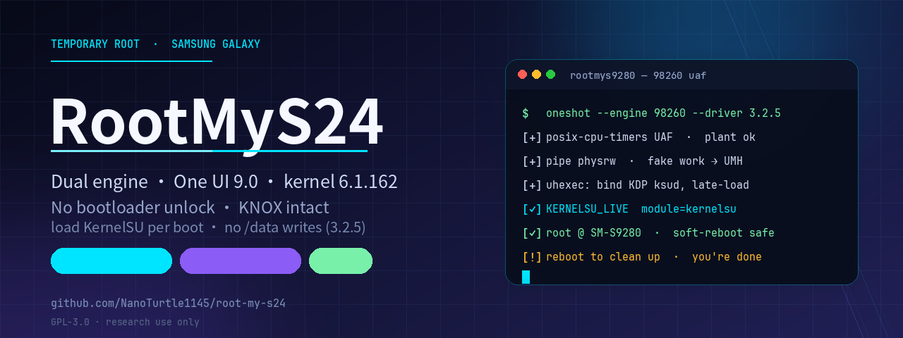

<p align="center">
  
</p>

<h1 align="center">RootMyS24</h1>

<p align="center">
  免解锁 root · Samsung Galaxy S24 系列（S9210 / S9260 / S9280 / S921E）与折叠屏<br>
  双引擎：<strong>CVE-2026-98260</strong>（98260 UAF）· <strong>CVE-2026-43499</strong>（GhostLock）<br>
  支持 One UI 9.0 / 内核 6.1.162，不写 boot、不熔断 KNOX
</p>

<p align="center">
  <a href="https://github.com/NanoTurtle1145/root-my-s24/releases"></a>
  <a href="https://github.com/NanoTurtle1145/root-my-s24/releases"></a>
  <a href="https://github.com/NanoTurtle1145/root-my-s24/stargazers"></a>
  <a href="LICENSE"></a>
  <a href="https://github.com/NanoTurtle1145/root-my-s24"></a>
</p>

<p align="center">
  <b>简体中文</b> · <a href="README.zh-TW.md">繁體中文（台灣）</a> · <a href="README.zh-HK.md">繁體中文（香港）</a> · <a href="README.en.md">English</a>
</p>

> 隐私：运行日志怎么上报、设备标识和 IP 怎么处理，见 [隐私政策](docs/PRIVACY.md)。

> 安全研究声明：本项目仅用于安全研究与自有设备维护。使用内核漏洞提权存在导致系统崩溃、数据丢失、设备变砖的风险，使用者需自行承担一切后果。请勿用于非法用途。

---

## 最新版本 v3.6.3（2026-11-10）

- **运行日志本机存档 + 日志编号**：每轮日志落盘，运行日志页可复制编号、查看本机历史；反馈时贴编号即可
- **「禁用 KSU 模块」在 98260 路径生效**（issue #35）：late-load 前由 root 上下文移走模块，结束后恢复
- **3.2.5 路径最终确认**：软重启不再硬重启，Vector/Zygisk 软重启后可正常加载
- 98260 引擎继续覆盖 One UI 9.0 / 6.1.162：S9280 EZIF、S928B EZIF/EZJ1、S921E DZIF
- README 重整 + 新 banner（Swiss 21:9）；3.3.0 仍为实验档

完整说明见 [docs/release-v3.6.3.md](docs/release-v3.6.3.md)。

## 两种提权引擎

机型选择页 →「提权引擎」可切换：

| 引擎 | 漏洞 | 适用 | 说明 |
|---|---|---|---|
| **98260 UAF** | CVE-2026-98260（`exec: Cleanup POSIX timers right after de_thread()`，posix-cpu-timers UAF） | One UI 9.0 / 6.1.162 | 实现参考 [SamTimer v1.3](https://github.com/RiosWesley/SamTimer)；走 UMH pipe 链路，**不写 cred** |
| **GhostLock 43499** | CVE-2026-43499（rtmutex/futex waiter UAF） | 旧固件（6.1.145 及更早） | 本项目的原始引擎 |

### 98260 载荷的 per-target 结构（issue #40）

98260 引擎的公共载荷是 `samtimer/libtimer`（EZIF/EZJ1）。其他构建号的适配按下面的约定叠加：

```
app/src/main/assets/samtimer/targets/<TAG>/libtimer   # 必需，按构建号编译的载荷
app/src/main/assets/samtimer/targets/<TAG>/uhexec     # 可选，与公共版本不同才放
app/src/main/assets/samtimer/targets/<TAG>/ksud       # 可选，公共 3.2.5 加载不了才放
```

- `<TAG>` = 完整构建号大写（如 `S9280ZCS6DZJ3`）
- 运行时优先用 `targets/<当前构建号>/`，不存在则回退公共载荷
- 源码放 `app/src/main/cpp/targets/<TAG>/`，PR 附 SHA-256 / 体积 / 编译命令 / 定标记录

### 98260 UAF 链路

```
timer UAF → pipe 读写原语 → 伪造 workqueue → call_usermodehelper
→ uhexec → 私有 mount ns 里 bind-mount KDP ksud → late-load 加载 KSU 驱动
```

- exploit 跑在 **Shizuku UserService 常驻进程**里，App 切后台不会被回收
- 失败时 `parking without reap (zombie held)` 是保护动作：让 victim 永远 zombie，内核走不到会 panic 的清理路径
- parked 进程不能强杀；**一次开机只尝试一次**，失败就重启（v3.6.2 起 App 会强制拦截重复尝试）

### 驱动选择（98260 引擎）

| 版本 | late-load 行为 | 结果 |
|---|---|---|
| **3.2.5**（默认，推荐） | `--ephemeral`：只加载模块，不写 /data/adb、不跑 module stage | 不自动打开 KSU 管理器，也不软重启 |
| 3.3.0（实验） | stock 多 KMI KDP，完整 late-load | 可用，但会重启管理器 + 软重启一次；其模块在 6.1.162 上偶发 system_server 崩溃循环，**不推荐** |

> 3.3.0 的 `--ephemeral` 是我们给 3.2.5 那套 ksud 打的补丁；现成 3.3.0 构建没有这个分支。
> 3.3.0 的 DDK 构建（内嵌 DZH3 模块）在 EZIF 上加载即 panic，不要用。

## 使用情况

> 以下为**匿名聚合**统计（数据来自 App 内可选的运行日志共享）：不含 IP、城市或任何设备标识。
> 图表由项目服务器动态生成，随数据自动更新。

<p align="center">
  
</p>

<p align="center">
  
</p>

<p align="center">
  
</p>

<p align="center">
  
</p>

## 仓库统计

> 以下图表由项目服务器基于 GitHub 公开 API 动态生成，自动更新（Star、Issue / PR 与下载量）。

<p align="center">
  
</p>

<p align="center">
  
</p>

<p align="center">
  
</p>

<p align="center">
  
</p>

## 特性

- 免解锁 bootloader：不刷 BL、不升 rev bit，bootloader 保持锁定
- 不熔断 KNOX：e-fuse 状态保持原样（可搭配 KnoxPatch 恢复 Secure Folder 等 KNOX 功能）
- 半持久化：每次重启后运行一次 App 即可重新加载 KernelSU 驱动
- **双引擎可选**：98260 UAF（One UI 9.0 / 6.1.162）与 GhostLock 43499（旧固件）
- **KernelSU 驱动版本可选**：3.2.5（98260 默认，稳定）/ 3.3.0（实验）；版本清单由服务端在线下发
- **SELinux 隐藏（仅 3.3.0 驱动）**：管理器显示「强制执行」而内核实际宽容模式
- **一次开机只跑一次**：v3.6.2 起检测到同开机重复尝试会直接拦截（脏状态会导致 exploit panic）
- **运行日志本机存档 + 日志编号**：每轮日志落盘，反馈时只要贴编号
- 「已实测」标记在线获取：机型卡片的实测状态由服务端下发，无需等 App 更新
- 现代 Material 3 界面：动态 ambience 头部、悬浮导航、多语言
- 首次启动必读指南：说明临时 root 不解锁 bootloader、重启即恢复，警告不要用 KernelSU 永久安装
- 运行日志共享（可选）：始终提供 / 每次询问 / 不提供
- 调试模式：设置页点版本号七下开启

## 支持设备

### 已实测成功

| 机型 | 固件 | 内核 | 载荷 | 状态 |
|---|---|---|---|---|
| SM-S9280（国行 DZF2） | S9280ZCS6DZF2 | 6.1.145 | `cve-2026-43499-S9280ZCS6DZF2` | 基线，已实测 |
| SM-S9280（国行 DZH3） | S9280ZCS6DZH3 | 6.1.145 | 同 DZF2 | 已实测，KernelSU 3.3.0 适配完成 |
| SM-S9280（港版/台版 DZE2） | S9280ZHS6DZE2 | 6.1.145 | `cve-2026-43499-dze2` | 已实测（港台同构建号共用） |
| SM-S9280（港版/台版 DZH3） | S9280ZHS6DZH3 | 6.1.145 | 同外版 DZE2 | 已实测（外版共用） |
| SM-S9280（国行 DZG1） | S9280ZCS6DZG1 | 6.1.145 | 同 DZF2 | 已实测（v2.5.6 起并入） |
| SM-S9210（国行 DZI1） | S9210ZCS6DZI1 | 6.1.145 | `cve-2026-43499-S9210ZCS6DZI1` | 已实测（attempt 1/24，e1q） |
| SM-S9260（台版 DZG1） | S9260ZHS6DZG1 | 6.1.145 | 港台 DZE2 载荷 | 单设备实测（issue #3） |
| SM-F741N（韩版 Z Flip6） | F741NKSS4DZE1 | 6.1.145 | `cve-2026-43499-F741NKSS4DZE1` | 已实测（beta.191，issue #16） |
| SM-F9580（国行 Z Fold6） | 共用 DZF2 | 6.1.145 | 同 DZF2 | 酷安用户实测成功 |
| SM-S928B（欧版 S24 Ultra，One UI 9.0） | S928BXXU6EZIF | 6.1.162 | `cve-2026-43499-S928BXXU6EZIF` | 已实测（2026-10-23） |
| **SM-S9280（港版/国行 EZIF，One UI 9.0）** | S9280ZHU6EZIF | 6.1.162 | 引擎：**98260 UAF**（实现参考 SamTimer v1.3） | **已实测（2026-11-07）**，KSU 3.2.5 驱动 |
| SM-S921E（国际版 S24，One UI 9.0） | S921EXXU3DZIF | 6.1.162 | 引擎：98260 UAF（与 EZIF 同内核构建 34343818） | 已实测（2026-11-07，issue #33） |

### 已定标，待真机验证

| 机型 | 固件 | 内核 | 载荷 | 备注 |
|---|---|---|---|---|
| SM-S9280（港版/台版 CZA1） | S9280ZHS4CZA1 | 6.1.128 | `cve-2026-43499-cza1` | 港台共用 |
| SM-S9280（国行 CZA1） | S9280ZCS4CZA1 | 6.1.128 | `cve-2026-43499-cza1-chc` | 数据段偏移 +0x10000 |
| SM-S9280（国行 CZB2） | S9280ZCS4CZB2 | 6.1.128 | `cve-2026-43499-czb2` | 独立定标 + 32525 ksud |
| SM-S9210（国行 BYH7，One UI 7） | S9210ZCU4BYH7 | 6.1.99 | `cve-2026-43499-byh7` | 6.1.145 之前代际 |
| SM-S9310/S9360/S9380（国行 S25，One UI 8.5） | S9310/S9360/S9380ZCSCCZG1 | 6.6.98 | `cve-2026-43499-czg1` | Android 15 内核线，独立载荷 |
| SM-S928B（欧版，One UI 8.0） | S928BXXS4CZA1 | 6.1.128 | `cve-2026-43499-S928BXXS4CZA1` | 与港版 CZA1 同构建号但 `.rodata` 差 8 字节，**不可互换** |
| SM-S928B（欧版，One UI 7.0） | S928BXXU4BYD9 | 6.1.99 | `cve-2026-43499-S928BXXU4BYD9` | 独立定标 |
| SM-S928B（欧版，One UI 6.1） | S928BXXU4AXK5 | 6.1.75 | `cve-2026-43499-S928BXXU4AXK5` | 本 App 支持的最早 6.1 代际 |
| W9023N（国行 心系天下 W23） | W9023ZCSAIZF1 | 5.10.236 | `cve-2026-43499-W9023ZCSAIZF1` | cape/SM8450，Android 12，beta |

### 移植载荷（未经本 App 真机实测）

以下条目由 RootMyGalaxy 移植，运行时按 KASLR 定标，需在设置里打开「启用未经测试的载荷」才显示：

| 系列 | 平台/内核 | 覆盖 |
|---|---|---|
| S23（S9110/S9160/S9180） | 5.15 | 国行 FZE3 / FZG1，港版 FZE3+ |
| S24（S9210/S9260/S9280） | 6.1.145 | 国行 DZE2 / DZF2 / DZG1，港台 DZG1 |
| S25（S9310/S9360/S9370/S9380） | 6.6 | 国行 BZA1 / BZC1 / CZF1 / CZG1，港版 CZG1 |
| S26（S9420/S9470/S9480） | 6.12 | 国行 AZG1 |
| 折叠屏 | 5.15 / 6.1 / 6.6 | Z Flip5/6/7、Z Fold5/6/7 国行，F956U 美版，F966B 欧版 |
| 心系天下 | 6.1 / 6.6 | W25 DZF2/DZG3、W26 BZG3/BZF1 |

> 同平台（e3q/e1q）同构建号固件内核符号一致，可直接通用；港版与台版同构建号共用同一载荷。跨构建号需逐符号对比修正；跨平台/跨大版本需完整重新定标，且漏洞可能已被修复。适配方法与各目标定标报告见[文档导航](#文档导航)。
>
> **EZIF 条目同时覆盖 EZJ1（S9280ZHS6EZJ1 / S928BXXS6EZJ1）**：内核构建号同为 `34343818`，只是新构建串；
> 用 98260 引擎 + 3.2.5 驱动即可（不要用 3.3.0，该模块在 6.1.162 上会让 system_server 崩溃循环）。
>
> **国行 DZF2 载荷自 v3.5.0 起覆盖 DZE2–DZH3**（同一条 6.1.145 内核线）；外版 DZE2 载荷覆盖 DZE2–DZG1。
>
> ⚠ **美版 S24 系列（SM-S921U / S926U1 / S928U / S928U1）暂不支持**。按内核构建号为单位适配：美版 DZF2 构建号与国行不同，`kmalloc_caches` 0x176c6f8（美版）vs 0x176cbb8（国行）。美版 S24+（S926U1/XAA）DZE2 已完成定标（`cve-2026-43499-dze2-xaa`，p0 指纹按美版内核重生成），因缺真机实测暂未随包发布；S928U/U1 尚未取到 boot 镜像，`.rodata` 字符串区未核对。
## KernelSU 驱动版本

机型页有独立的「KernelSU 驱动版本」选项卡，切换它只决定**加载哪个 KernelSU 驱动**，exploit 载荷本身与版本无关。

| 版本 | 适用 | 说明 |
|---|---|---|
| **3.2.5（32525）** | 98260 引擎（默认） | **推荐**。`--ephemeral` late-load：不写 /data/adb、不跑 module stage、不自动打开管理器、不软重启 |
| 3.3.0（32601） | GhostLock 旧固件 / 实验 | 支持 SELinux 隐藏；但在 6.1.162 上 stock 模块偶发 system_server 崩溃循环，98260 引擎**不推荐** |

版本清单由服务端在线下发，且只对**提供该驱动的固件**生效——不适用的固件自动回退默认驱动，并在选项卡下方提示。

> 驱动只认**官方签名**的 KernelSU Manager。请安装官方 v3.3.0；装其它签名的版本会显示「未安装」。

## 使用流程

1. 安装 App，授权方式：
   - **Shizuku**（默认）：安装并启动 Shizuku（无线/有线 ADB 授权）
   - **无线调试**（实验性）：设置页开启「无线调试授权」后，主页支持通知配对 / 配对码 / 直连
2. 选择机型/固件，并在「**提权引擎**」里选引擎（One UI 9.0 选中 98260 UAF，旧固件选 GhostLock）
3. 在「**KernelSU 驱动版本**」里选驱动（98260 → 3.2.5；GhostLock 按机型默认）
4. 点击「开始 Root」。98260 建议：**一次开机只跑一次**，失败就重启再试
5. 安装 **官方 KernelSU Manager v3.3.0**，跑完后首页显示「工作中 [越狱模式]」

> 成功标记：98260 是 `KERNELSU_LIVE` / 模块已加载；GhostLock 是 `exploit completed` + `retval=0 socket=1`。
> 运行日志页可复制**日志编号**，反馈时贴编号即可。

## BakaSU 内核模式（实验）

设置卡里新增「BakaSU 内核（实验）」开关（默认关）。打开后 root 流程改用
**三星适配的 BakaSU LKM** 替代 KernelSU，并自动安装 BakaSU 管理器：

- 仅 **SM-S9280 / S9280ZCS6DZH3（内核 6.1.145）** 实测通过
- 每次开机需要重新运行（late-load 不持久，与 KernelSU 模式一致）
- **不要点管理器里的「安装/刷入」页面**（会写 boot，有变砖风险），装模块走「模块」页
- 详细说明见 [`docs/bakasu-kernel-mode.md`](docs/bakasu-kernel-mode.md)，
  构建与脚本仓库：<https://github.com/NanoTurtle1145/BakaSU-S9280>

---

## 文档导航

完整文档中心见 [docs/README.md](docs/README.md)。

### 入门与使用

- [docs/release-v3.6.3.md](docs/release-v3.6.3.md) —— 最新发布说明（日志编号 / 本机历史 / #35）
- [docs/release-v3.5.1.md](docs/release-v3.5.1.md) —— 最新发布说明（韩版 Z Flip6 支持 / BakaSU 实验模式 / 完整改动清单）
- [docs/release-v3.4.0.md](docs/release-v3.4.0.md) —— v3.4.0 发布说明
- [docs/forum-and-admin.md](docs/forum-and-admin.md) —— 讨论区与管理端说明
- [docs/auth-plan.md](docs/auth-plan.md) —— 授权方案规划（Shizuku / 无线调试各方案状态）
- [docs/release-v2.5.5.md](docs/release-v2.5.5.md) —— v2.5.5 发布说明（无线调试收敛为实验性开关）
- [docs/release-v2.2.md](docs/release-v2.2.md) —— v2.2 发布说明（历史）

### 技术原理

- [docs/technical-principles.md](docs/technical-principles.md) —— 本 App 技术原理（漏洞成因 / 利用链 / 为什么免解锁 / 风险）
- [研究仓库 VULNERABILITY_ANALYSIS.md](https://github.com/NanoTurtle1145/samsung-root-research/blob/main/VULNERABILITY_ANALYSIS.md) —— 完整漏洞原理剖析（研究笔记，权威）

### 固件适配与定标

- **[docs/adaptation-guide-full.md](docs/adaptation-guide-full.md) —— 完整适配指南（手把手，照着做即可；含判据与失败分类）⭐**
- [docs/adaptation-guide.md](docs/adaptation-guide.md) —— 适配方法论（旧版，偏原理）
- [docs/dze2-target-complete.md](docs/dze2-target-complete.md) —— 港版 DZE2 定标报告
- [docs/dzg1-target-complete.md](docs/dzg1-target-complete.md) —— 国行 DZG1 定标报告
- [docs/cza1-target-complete.md](docs/cza1-target-complete.md) —— 港版 CZA1 定标报告
- [docs/oneui7-adaptation-report.md](docs/oneui7-adaptation-report.md) —— One UI 7 (BYH7) 可行性报告
- [docs/byh7-target-complete.md](docs/byh7-target-complete.md) —— BYH7 定标完成报告
- [docs/f741n-dze1-target-complete.md](docs/f741n-dze1-target-complete.md) —— 韩版 F741N DZE1 定标报告（b6q）
- [docs/s928b-ezif-target-complete.md](docs/s928b-ezif-target-complete.md) —— S24 Ultra 欧版 S928B EZIF 定标报告（One UI 9.0）

### 运行日志与故障定位

- [docs/run-log-analysis.md](docs/run-log-analysis.md) —— 成功/失败日志逐行对比与判读
- [docs/sm-s9380-rmg-root-experience.md](docs/sm-s9380-rmg-root-experience.md) —— SM-S9380 实战经验归档

### 研究资料

- [docs/research-index.md](docs/research-index.md) —— 研究资料全量索引
- [docs/blog-s9280-root.md](docs/blog-s9280-root.md) —— 博客：S24 Ultra 国行免解锁 Root 实践
- [samsung-root-research](https://github.com/NanoTurtle1145/samsung-root-research) —— 研究仓库（固件/exploit 工程/定标报告权威镜像）

## 技术原理（概要）

- **GhostLock（CVE-2026-43499）**：rtmutex 内核栈 use-after-free。通过 PI futex 链死锁回滚触发错误清理路径，留下指向已释放内核栈的悬垂指针；复用该栈伪造 `rt_mutex_waiter` 后获得物理内存读写，依次绕过 KASLR、降级 SELinux、以 root 执行辅助程序，最终 late-load KernelSU 驱动。
- **98260 UAF（CVE-2026-98260）**：`exec: Cleanup POSIX timers right after de_thread()` 时序缺陷导致 posix-cpu-timers 的 `timerqueue_node` use-after-free。利用 pipe 读写原语伪造 workqueue → `call_usermodehelper` 以 root 执行 uhexec，在私有 mount ns 中 bind-mount KDP ksud 后 late-load。不写 cred，因此不触发 KDP/RKP/DEFEX 的凭据保护。

两条链全程不改动持久化分区，bootloader 保持锁定、KNOX e-fuse 不熔断。

> 完整原理见 [docs/technical-principles.md](docs/technical-principles.md) 与研究仓库 [VULNERABILITY_ANALYSIS.md](https://github.com/NanoTurtle1145/samsung-root-research/blob/main/VULNERABILITY_ANALYSIS.md)。

## 注意事项

- **停在已适配固件，不要升级**：新固件可能修复漏洞
- **98260 引擎一次开机只跑一次**：重复跑会让内核状态变脏、exploit 在 plant 中途 panic；失败就重启
- exploit 概率性成功：GhostLock 失败可多试，98260 失败要重启
- 运行期间建议熄屏（降低内核竞态概率）；系统负载高时成功率骤降
- 每次重启后需要重新运行一次「开始 Root」加载 KernelSU 驱动
- **跑完别久留**：exploit 会留 parked 进程占住内核页；拿到 root 后把事做完就重启，避免长时间高负载
- **管理器必须用官方 KernelSU v3.3.0**：内核驱动只认官方签名
- **3.3.0 驱动在 6.1.162 上不稳**：偶发 system_server 崩溃循环 → RescueParty → 整机重启；98260 请用 3.2.5

---

## 构建

```sh
./gradlew :app:assembleDebug    # debug APK
./gradlew :app:assembleRelease  # release APK（需自行配置签名）
```

版本号由 git 推导（`versionCode` = 提交数，`versionName` = 最近的 tag），预发布渠道会追加后缀：

```sh
./gradlew :app:assembleRelease -Prms24Channel=alpha1   # 引擎试验包
./gradlew :app:assembleRelease -Prms24Channel=beta1    # 机型/固件适配预览
./gradlew :app:assembleRelease -Prms24Channel=stable   # 正式版
```

产物命名 `RootMyS24-v{版本}-{渠道}-build{versionCode}.apk`。

载荷（exploit / root helper / ksud）已内置在 `app/src/main/assets/`，构建链属开发者职责。

## 依赖与致谢

- [CVE-2026-43499](https://github.com/NebuSec/CyberMeowfia/tree/main/IonStack/CVE-2026-43499) 安全研究（IonStack / NebuSec）
- [SamTimer](https://github.com/RiosWesley/SamTimer)（98260 引擎参考实现；安全拆除补丁已提交 [PR #2](https://github.com/RiosWesley/SamTimer/pull/2)）
- [Root-My-Galaxy](https://github.com/BuSung-dev/Root-My-Galaxy) 免解锁 root 参考工程
- [KernelSU](https://github.com/tiann/KernelSU)（GPL-2.0）
- [Zygisk-Next](https://github.com/Dr-TSNG/ZygiskNext)
- [LSPosed](https://github.com/LSPosed/LSPosed)（GPL-3.0）
- [KnoxPatch](https://github.com/salvogiangri/KnoxPatch)
- [Vector](https://github.com/JingMatrix/Vector) 界面模板（Material 3 / ambience）

## License

[GNU General Public License v3.0](LICENSE)
