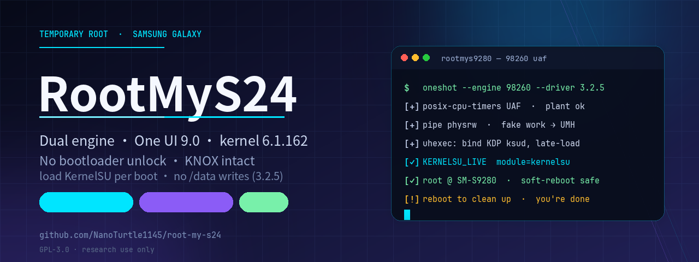

<p align="center">
  
</p>

<h1 align="center">RootMyS24</h1>

<p align="center">
  免解鎖 bootloader 的三星臨時 root · root 只活到重啓，不寫 boot、不熔斷 KNOX<br>
  雙引擎：<strong>CVE-2026-98260</strong>（98260 UAF，One UI 9.0 / 6.1.162）·
  <strong>CVE-2026-43499</strong>（GhostLock，6.1.145 及更早）
</p>

<p align="center">
  <a href="https://github.com/NanoTurtle1145/root-my-s24/releases"></a>
  <a href="https://github.com/NanoTurtle1145/root-my-s24/releases"></a>
  <a href="https://github.com/NanoTurtle1145/root-my-s24/stargazers"></a>
  <a href="LICENSE"></a>
  <a href="https://github.com/NanoTurtle1145/root-my-s24/blob/main/CONTRIBUTING.md"></a>
</p>

<p align="center">
  <b>簡體中文</b> · <a href="README.zh-TW.md">繁體中文（台灣）</a> · <a href="README.zh-HK.md">繁體中文（香港）</a> · <a href="README.en.md">English</a>
  &nbsp;|&nbsp; <a href="docs/README.md">文檔中心</a> · <a href="CONTRIBUTING.md">貢獻指南</a> · <a href="docs/PRIVACY.md">隱私政策</a>
</p>

> **聲明**：僅用於安全研究與自有設備維護。使用內核漏洞提權存在系統崩潰、數據丟失、設備變磚的風險，後果自負；請勿用於非法用途。
> 運行日誌共享是可選項，怎麼上報、設備標識與 IP 如何處理見[隱私政策](docs/PRIVACY.md)。

---

## 一、這是什麼

一個跑在三星 Galaxy（主要是 S24 系列及摺疊屏）上的**臨時 root** 工具：

- **免解鎖**：不刷 BL、不寫 boot，`ro.boot.flash.locked` 保持 1
- **不熔斷**：KNOX e-fuse 不變（`warranty_bit` 保持 0）
- **半持久**：每次重啓後跑一次 App 重新加載 KernelSU 驅動，重啓即乾淨
- **雙引擎**：新固件走 98260 UAF，舊固件走 GhostLock 43499
- **一條鏈路到 KernelSU**：拿到 root 後 late-load KernelSU LKM，支持 Zygisk Next / LSPosed / KnoxPatch 等模塊

| 引擎 | 漏洞 | 適用固件 | 關鍵點 |
|---|---|---|---|
| **98260 UAF** | CVE-2026-98260（`exec: Cleanup POSIX timers right after de_thread()`，posix-cpu-timers UAF） | One UI 9.0 / 內核 6.1.162 | 實現參考 [SamTimer v1.3](https://github.com/RiosWesley/SamTimer)；UMH 鏈路，**不寫 cred**，不撞 KDP/RKP/DEFEX |
| **GhostLock 43499** | CVE-2026-43499（rtmutex/futex waiter 內核棧 UAF） | 6.1.145 及更早 | 本項目的原始引擎；較新固件已修復 |

## 二、快速開始

### 需要什麼

| 項 | 要求 |
|---|---|
| 設備 | 見下方「支持設備」表；固件構建號必須在覆蓋範圍內 |
| 授權 | **Shizuku**（推薦）或 App 內「無線調試」直連 |
| 管理器 | 與驅動版本匹配的**官方簽名** KernelSU 管理器（見下表） |
| 環境 | 建議熄屏運行、系統負載低、一輪跑完前別切後台 |

### 三步

1. **選機型固件** → 機型頁選你的構建號
2. **選引擎與驅動** → One UI 9.0 選 `98260 UAF` + 驅動 `3.2.5`；舊固件選 `GhostLock`（默認驅動即可）
3. **開始 Root** → 成功後裝管理器，`su` 即可用

### 管理器版本必須與驅動匹配

| App 裏選的驅動 | 裝哪個管理器 |
|---|---|
| **3.2.5（32525）** — 98260 默認 | 官方 **v3.2.5（32525）** |
| 3.3.0（32601）— 實驗 | 官方 **v3.3.0（32601）** |

> 版本錯配時 `su` 可能還能用，但管理器會顯示「未安裝」或裝不了模塊。重簽名 / fork 版管理器一律「未安裝」（驅動只認官方簽名）。
> **不要點管理器裏的「安裝 / 刷入」**：那是永久安裝，會寫 boot，鎖定 BL 上有變磚風險。裝模塊只用「模塊」頁。

### 98260 引擎的三條硬規則

1. **一次開機只跑一次** —— 失敗 / 軟重啓後先重啓手機再跑，髒狀態繼續跑會在 plant 中途 panic（v3.6.2 起 App 會直接攔截）
2. **別用 3.3.0 驅動** —— 該驅動在 6.1.162 上會讓 system_server 崩潰循環，用 3.2.5
3. **看到 `parking without reap (zombie held)` 就重啓** —— 這是保護動作（parked 進程拿住頁），不能強殺

### 出問題了怎麼反饋

運行日誌頁 →「複製編號」（v3.6.3 起），把**日誌編號**貼進 issue 即可；模板會自動要求機型、固件、內核、引擎、驅動。沒有編號時貼完整日誌也行。

## 三、支持設備

### 已實測成功

| 機型 | 固件 | 內核 | 載荷 | 狀態 |
|---|---|---|---|---|
| SM-S9280（國行 DZF2） | S9280ZCS6DZF2 | 6.1.145 | `cve-2026-43499-S9280ZCS6DZF2` | 基線，已實測 |
| SM-S9280（國行 DZH3） | S9280ZCS6DZH3 | 6.1.145 | 同 DZF2 | 已實測，KernelSU 3.3.0 適配完成 |
| SM-S9280（港版/台版 DZE2） | S9280ZHS6DZE2 | 6.1.145 | `cve-2026-43499-dze2` | 已實測（港台同構建號共用） |
| SM-S9280（港版/台版 DZH3） | S9280ZHS6DZH3 | 6.1.145 | 同外版 DZE2 | 已實測（外版共用） |
| SM-S9280（國行 DZG1） | S9280ZCS6DZG1 | 6.1.145 | 同 DZF2 | 已實測（v2.5.6 起併入） |
| SM-S9210（國行 DZI1） | S9210ZCS6DZI1 | 6.1.145 | `cve-2026-43499-S9210ZCS6DZI1` | 已實測（attempt 1/24，e1q） |
| SM-S9260（台版 DZG1） | S9260ZHS6DZG1 | 6.1.145 | 港台 DZE2 載荷 | 單設備實測（issue #3） |
| SM-F741N（韓版 Z Flip6） | F741NKSS4DZE1 | 6.1.145 | `cve-2026-43499-F741NKSS4DZE1` | 已實測（beta.191，issue #16） |
| SM-F9580（國行 Z Fold6） | 共用 DZF2 | 6.1.145 | 同 DZF2 | 酷安用户實測成功 |
| SM-S928B（歐版 S24 Ultra，One UI 9.0） | S928BXXU6EZIF | 6.1.162 | `cve-2026-43499-S928BXXU6EZIF` | 已實測（2026-10-23） |
| **SM-S9280（港版/國行 EZIF，One UI 9.0）** | S9280ZHU6EZIF | 6.1.162 | 引擎：**98260 UAF**（實現參考 SamTimer v1.3） | **已實測（2026-11-07）**，KSU 3.2.5 驅動 |
| SM-S921E（國際版 S24，One UI 9.0） | S921EXXU3DZIF | 6.1.162 | 引擎：98260 UAF（與 EZIF 同內核構建 34343818） | 已實測（2026-11-07，issue #33） |
| SM-S928B（歐版 S24 Ultra，EZJ1） | S928BXXS6EZJ1 | 6.1.162 | 引擎：98260 UAF（同 34343818） | 已實測（2026-11-10，issue #32） |

### 已定標，待真機驗證

| 機型 | 固件 | 內核 | 載荷 | 備註 |
|---|---|---|---|---|
| SM-S9280（港版/台版 CZA1） | S9280ZHS4CZA1 | 6.1.128 | `cve-2026-43499-cza1` | 港台共用 |
| SM-S9280（國行 CZA1） | S9280ZCS4CZA1 | 6.1.128 | `cve-2026-43499-cza1-chc` | 數據段偏移 +0x10000 |
| SM-S9280（國行 CZB2） | S9280ZCS4CZB2 | 6.1.128 | `cve-2026-43499-czb2` | 獨立定標 + 32525 ksud |
| SM-S9210（國行 BYH7，One UI 7） | S9210ZCU4BYH7 | 6.1.99 | `cve-2026-43499-byh7` | 6.1.145 之前代際 |
| SM-S9310/S9360/S9380（國行 S25，One UI 8.5） | S9310/S9360/S9380ZCSCCZG1 | 6.6.98 | `cve-2026-43499-czg1` | Android 15 內核線，獨立載荷 |
| SM-S928B（歐版，One UI 8.0） | S928BXXS4CZA1 | 6.1.128 | `cve-2026-43499-S928BXXS4CZA1` | 與港版 CZA1 同構建號但 `.rodata` 差 8 字節，**不可互換** |
| SM-S928B（歐版，One UI 7.0） | S928BXXU4BYD9 | 6.1.99 | `cve-2026-43499-S928BXXU4BYD9` | 獨立定標 |
| SM-S928B（歐版，One UI 6.1） | S928BXXU4AXK5 | 6.1.75 | `cve-2026-43499-S928BXXU4AXK5` | 本 App 支持的最早 6.1 代際 |
| W9023N（國行 心繫天下 W23） | W9023ZCSAIZF1 | 5.10.236 | `cve-2026-43499-W9023ZCSAIZF1` | cape/SM8450，Android 12，beta |
| **SM-S9280（國行 DZJ3）** | S9280ZCS6DZJ3 | 6.1.145 | 引擎：**98260 UAF**（per-target `samtimer/targets/S9280ZCS6DZJ3`） | 社區定標（#40/PR #44）：手動 staging 真機 root 成功；App 內待驗證（`tested=false`） |

### 移植載荷（未經本 App 真機實測）

以下條目由 RootMyGalaxy 移植，運行時按 KASLR 定標，需在設置裏打開「啓用未經測試的載荷」才顯示：

| 系列 | 平台/內核 | 覆蓋 |
|---|---|---|
| S23（S9110/S9160/S9180） | 5.15 | 國行 FZE3 / FZG1，港版 FZE3+ |
| S24（S9210/S9260/S9280） | 6.1.145 | 國行 DZE2 / DZF2 / DZG1，港台 DZG1 |
| S25（S9310/S9360/S9370/S9380） | 6.6 | 國行 BZA1 / BZC1 / CZF1 / CZG1，港版 CZG1 |
| S26（S9420/S9470/S9480） | 6.12 | 國行 AZG1 |
| 摺疊屏 | 5.15 / 6.1 / 6.6 | Z Flip5/6/7、Z Fold5/6/7 國行，F956U 美版，F966B 歐版 |
| 心繫天下 | 6.1 / 6.6 | W25 DZF2/DZG3、W26 BZG3/BZF1 |

> 同平台（e3q/e1q）同構建號固件內核符號一致，可直接通用；港版與台版同構建號共用同一載荷。跨構建號需逐符號對比修正；跨平台/跨大版本需完整重新定標，且漏洞可能已被修復。適配方法與各目標定標報告見[文檔導航](#九文檔導航)。
>
> **EZIF 條目同時覆蓋 EZJ1（S9280ZHS6EZJ1 / S928BXXS6EZJ1）**：內核構建號同為 `34343818`，只是新構建串；
> 用 98260 引擎 + 3.2.5 驅動即可（不要用 3.3.0，該模塊在 6.1.162 上會讓 system_server 崩潰循環）。
>
> **國行 DZF2 載荷自 v3.5.0 起覆蓋 DZE2–DZH3**（同一條 6.1.145 內核線）；外版 DZE2 載荷覆蓋 DZE2–DZG1。
>
> ⚠ **美版 S24 系列（SM-S921U / S926U1 / S928U / S928U1）暫不支持**。按內核構建號為單位適配：美版 DZF2 構建號與國行不同，`kmalloc_caches` 0x176c6f8（美版）vs 0x176cbb8（國行）。美版 S24+（S926U1/XAA）DZE2 已完成定標（`cve-2026-43499-dze2-xaa`，p0 指紋按美版內核重生成），因缺真機實測暫未隨包發佈；S928U/U1 尚未取到 boot 鏡像，`.rodata` 字符串區未核對。

## 四、引擎與驅動（進階）

### 98260 UAF 鏈路

```
timer UAF → pipe 讀寫原語 → 偽造 workqueue → call_usermodehelper
→ uhexec → 私有 mount ns 裏 bind-mount KDP ksud → late-load 加載 KernelSU 驅動
```

- exploit 跑在 **Shizuku UserService 常駐進程**裏，App 切後台不會被回收
- 失敗時 `parking without reap (zombie held)` 是保護動作：讓 victim 永遠 zombie，內核走不到會 panic 的清理路徑
- v3.6.2 起有**安全拆除（safe unlink）**：parked 前把 held victim 的 3 個 CPU-clock timerqueue 樹根置空，軟重啓不再演變成硬重啓（補丁已提交上游 [SamTimer PR #2](https://github.com/RiosWesley/SamTimer/pull/2)）

### 98260 載荷的 per-target 結構

公共載荷是 `samtimer/libtimer`（覆蓋 EZIF/EZJ1）。其他構建號的適配按下面的約定疊加，**不改公共載荷**：

```
app/src/main/assets/samtimer/targets/<TAG>/libtimer   # 必需，按構建號編譯的載荷
app/src/main/assets/samtimer/targets/<TAG>/uhexec     # 可選，與公共版本不同才放
app/src/main/assets/samtimer/targets/<TAG>/ksud       # 可選，公共 3.2.5 加載不了才放
```

- `<TAG>` = 完整構建號大寫（如 `S9280ZCS6DZJ3`）；運行時優先 targets 目錄，缺失回退公共載荷
- 目前已合入：`S9280ZCS6DZJ3`（社區貢獻，PR #44；手動 staging 真機驗證通過，App 內待驗證 → `tested=false`）
- 適配流程與 PR 要求見 [CONTRIBUTING.md](CONTRIBUTING.md) →「98260 載荷適配」

### 驅動版本

| 版本 | 適用 | 説明 |
|---|---|---|
| **3.2.5（32525）** | 98260 引擎（默認） | **推薦**。`--ephemeral` late-load：不寫 /data/adb、不跑 module stage、不自動打開管理器、不軟重啓 |
| 3.3.0（32601） | GhostLock 舊固件 / 實驗 | 支持 SELinux 隱藏；6.1.162 上 stock 模塊偶發 system_server 崩潰循環，98260 引擎**不推薦** |

版本清單由服務端在線下發，只對提供該驅動的固件生效，不適用的固件自動回退默認驅動並提示。

### BakaSU 內核模式（實驗）

設置裏「BakaSU 內核（實驗）」開關（默認關）改用三星適配的 BakaSU LKM：

- 僅 **SM-S9280 / S9280ZCS6DZH3（6.1.145）** 實測通過
- 每次開機需重跑；**別點管理器「安裝/刷入」**
- 詳見 [docs/bakasu-kernel-mode.md](docs/bakasu-kernel-mode.md)，構建倉庫 <https://github.com/NanoTurtle1145/BakaSU-S9280>

## 五、注意事項

- **停在已適配固件**：升級可能修掉漏洞；新固件優先按「支持設備」表核對構建號
- exploit 概率性成功：GhostLock 失敗可多試，98260 **失敗要重啓**
- 運行期間建議熄屏、別切後台、別開省電；系統負載高時成功率驟降
- 每次重啓後需要重新跑一次「開始 Root」
- **跑完別久留**：exploit 會留 parked 進程佔住內核頁，事情做完就重啓；避免長時間高負載（遊戲 / 大量後台 / 反覆鎖屏）
- **管理器版本與驅動匹配**且必須官方簽名（見「二、快速開始」）
- 3.3.0 驅動在 6.1.162 上不穩（system_server 崩潰循環 → RescueParty → 整機重啓）

## 六、版本歷史

| 版本 | 時間 | 要點 |
|---|---|---|
| [v3.6.4-beta.1](docs/release-v3.6.4-beta.1.md) | 2026-11-14 | 預發佈：per-target 載荷（首個 DZJ3）、#35 禁用模塊改 disable 標記 |
| [v3.6.3](docs/release-v3.6.3.md) | 2026-11-10 | 運行日誌本機存檔 + 日誌編號、本機歷史日誌 |
| [v3.6.2](docs/release-v3.6.2.md) | 2026-11-08 | 安全拆除（軟重啓不再硬重啓）、一次開機一次嘗試強制 |
| [v3.6.0](docs/release-v3.6.0.md) | 2026-11-07 | 新增 98260 UAF 引擎（雙引擎切換） |
| [v3.5.x](docs/README.md#一入門與使用) | 2026-10 | KSU 3.3.0 適配、歐版 EZIF 支持、BakaSU 實驗、地區分組等 |

完整歷史見 [docs/README.md](docs/README.md) 的發佈分組。

## 七、項目結構

```
RootMyS24/
├── app/                     主 App（Kotlin + Jetpack Compose）
│   └── src/main/
│       ├── kotlin/cn/nanoturtle/rootmys9280/manager/
│       │   ├── rootmy/      提權流程核心（RootViewModel / 引擎 / UserService / 載荷選擇）
│       │   ├── ui/          Compose 界面（首頁 / 機型頁 / 設置 / 日誌 / 關於）
│       │   ├── data/        日誌解析與本地存儲
│       │   ├── net/         服務端接口（公告 / 載荷清單 / 日誌上報）
│       │   └── ipc/、di/    進程通信與依賴注入
│       ├── cpp/             exploit 源碼
│       │   ├── timer_samtimer.c        98260 UAF 公共載荷（含 safe unlink）
│       │   └── targets/<TAG>/          按構建號的 offsets.h（如 S9280ZCS6DZJ3）
│       ├── aidl/            UserService 接口（IRootService / IRootCallback）
│       ├── assets/
│       │   ├── cve-2026-43499*         GhostLock 載荷與 root helper
│       │   └── samtimer/               98260 引擎：libtimer / uhexec / action 腳本 / ksud
│       │       └── targets/<TAG>/      per-target 載荷
│       ├── res/            多語言資源（20+ 語言）
│       └── AndroidManifest.xml
├── manager-ui/              管理器 UI 複用模塊
├── services/manager-service/ 前台服務模塊
├── server/                  自建接口（公告 / 載荷清單 / 論壇 / 統計）
├── tools/                   構建與發佈腳本（ci_release / release_flavors / split_assets）
├── docs/                    文檔：發佈説明、定標報告、技術原理、隱私政策
├── .github/workflows/       CI：簽名構建 + GitHub Release
└── .github/ISSUE_TEMPLATE/  Issue 模板（Bug / 成功反饋 / 功能建議）
```

各目錄職責：

| 目錄 | 職責 |
|---|---|
| `app/src/main/kotlin/.../rootmy/` | 雙引擎調度、Shizuku/無線調試授權、載荷與驅動選擇、late-load、日誌 |
| `app/src/main/cpp/` | exploit 與載荷源碼（按目標放 `targets/<TAG>/offsets.h`） |
| `app/src/main/assets/` | 隨包分發的二進制載荷與腳本（構建鏈在開發者側） |
| `server/` | App 在線能力：公告、載荷/驅動清單、運行統計、論壇 |
| `tools/` | 發佈流水線輔助腳本 |
| `docs/` | 全部文檔（索引見 [docs/README.md](docs/README.md)） |

## 八、構建

```sh
./gradlew :app:assembleDebug    # debug APK
./gradlew :app:assembleRelease  # release APK（需自行配置簽名）
```

版本號由 git 推導（`versionCode` = 提交數，`versionName` = 最近的 tag），預發佈渠道會追加後綴：

```sh
./gradlew :app:assembleRelease -Prms24Channel=alpha1   # 引擎試驗包
./gradlew :app:assembleRelease -Prms24Channel=beta1    # 機型/固件適配預覽
./gradlew :app:assembleRelease -Prms24Channel=stable   # 正式版
```

產物命名 `RootMyS24-v{版本}-{渠道}-build{versionCode}.apk`。

> 渠道語義：`alphaN` = 引擎/框架試驗，`betaN` = 機型/固件適配預覽，`stable` = 正式發佈。
> 打 tag 推送到 GitHub 會觸發 `.github/workflows/release.yml` 自動簽名構建併發 Release（詳見 [docs/ci-release.md](docs/ci-release.md)）。

載荷（exploit / root helper / ksud）已內置在 `app/src/main/assets/`，構建鏈屬開發者職責。

## 九、文檔導航

完整索引見 [docs/README.md](docs/README.md)。

| 分類 | 文檔 |
|---|---|
| 入門 | [快速開始](#二快速開始) · [貢獻指南](CONTRIBUTING.md) · [授權方案](docs/auth-plan.md) · [隱私政策](docs/PRIVACY.md) |
| 原理 | [技術原理](docs/technical-principles.md) · [研究倉庫 VULNERABILITY_ANALYSIS.md](https://github.com/NanoTurtle1145/samsung-root-research/blob/main/VULNERABILITY_ANALYSIS.md) |
| 適配 | [完整適配指南 ⭐](docs/adaptation-guide-full.md) · [適配方法論](docs/adaptation-guide.md) · [CONTRIBUTING → 機型適配](CONTRIBUTING.md#機型適配最有價值的貢獻) |
| 定標報告 | [DZJ3（98260）](docs/port-98260-S9280ZCS6DZJ3.md) · [S9210 DZI1](docs/port-e1q-S9210ZCS6DZI1.md) · [DZE2](docs/dze2-target-complete.md) · [CZA1](docs/cza1-target-complete.md) · [DZG1](docs/dzg1-target-complete.md) · [F741N DZE1](docs/f741n-dze1-target-complete.md) · [S928B EZIF](docs/s928b-ezif-target-complete.md) · [BYH7](docs/byh7-target-complete.md) |
| 日誌與排障 | [運行日誌判讀](docs/run-log-analysis.md) · [SM-S9380 實戰](docs/sm-s9380-rmg-root-experience.md) |
| 發佈與 CI | [發佈説明索引](docs/README.md#一入門與使用) · [CI 與發佈](docs/ci-release.md) · [分系列構建](docs/separate-builds.md) |
| 實驗 | [BakaSU 內核模式](docs/bakasu-kernel-mode.md) · [DirtyFrag 引擎規劃](docs/dirtyfrag-engine-plan.md) |

## 十、技術原理（概要）

- **98260 UAF**：`exec: Cleanup POSIX timers right after de_thread()` 時序缺陷 → posix-cpu-timers 的 `timerqueue_node` use-after-free。pipe 讀寫原語偽造 workqueue → `call_usermodehelper` 以 root 執行 uhexec，在私有 mount ns 中 bind-mount KDP ksud 後 late-load。**不寫 cred**，不觸發 KDP/RKP/DEFEX 的憑據保護。
- **GhostLock 43499**：rtmutex 內核棧 use-after-free。PI futex 鏈死鎖回滾觸發錯誤清理路徑，留下指向已釋放內核棧的懸垂指針；複用該棧偽造 `rt_mutex_waiter` 獲得物理內存讀寫，繞過 KASLR、降級 SELinux、以 root 執行 helper，最後 late-load KernelSU。

兩條鏈都不改動持久化分區，bootloader 保持鎖定、KNOX e-fuse 不熔斷。詳見 [docs/technical-principles.md](docs/technical-principles.md)。

## 十一、項目數據

> 匿名聚合統計（App 內可選的運行日誌共享）：不含 IP、城市或任何設備標識；圖表由項目服務器動態生成。

<p align="center">
  
</p>

<p align="center">
  
</p>

<p align="center">
  
</p>

<p align="center">
  
</p>

<details>
<summary>更多圖表（地區分佈 / Star 增長 / Issue-PR 歷史 / 下載量）</summary>

<p align="center">
  
</p>

<p align="center">
  
</p>

<p align="center">
  
</p>

<p align="center">
  
</p>

</details>

## 十二、依賴與致謝

- [CVE-2026-43499](https://github.com/NebuSec/CyberMeowfia/tree/main/IonStack/CVE-2026-43499) 安全研究（IonStack / NebuSec）
- [SamTimer](https://github.com/RiosWesley/SamTimer) —— 98260 引擎參考實現；安全拆除補丁已回提 [PR #2](https://github.com/RiosWesley/SamTimer/pull/2)
- [Root-My-Galaxy](https://github.com/BuSung-dev/Root-My-Galaxy) / [Root-My-Galaxy-Payloads](https://github.com/BuSung-dev/Root-My-Galaxy-Payloads) 免解鎖 root 參考工程與載荷（Apache-2.0）
- [KernelSU](https://github.com/tiann/KernelSU)（GPL-2.0）
- [Zygisk-Next](https://github.com/Dr-TSNG/ZygiskNext) · [LSPosed](https://github.com/LSPosed/LSPosed)（GPL-3.0）· [KnoxPatch](https://github.com/salvogiangri/KnoxPatch)
- [Vector](https://github.com/JingMatrix/Vector) 界面模板（Material 3 / ambience）
- 以及所有提交 issue、測試新固件的用户

## License

[GNU General Public License v3.0](LICENSE)。第三方組件許可見 [THIRD_PARTY_NOTICES](docs/README.md) 與各載荷目錄內的聲明。
